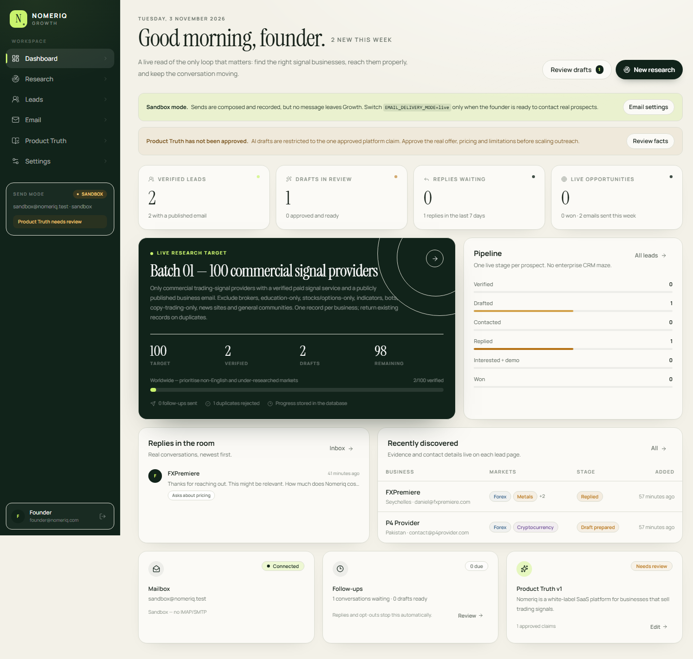

# Nomeriq Growth

An independent, founder-controlled B2B sales portal for Nomeriq. It exists to run one loop exceptionally well:

**Find commercial trading-signal providers → verify the signal business and public email → reject duplicates → save evidence → write a personalized first email → founder review → send → receive and thread replies → respond or follow up → track the outcome → repeat.**

This is a standalone application with its own Git repository, database, authentication, encrypted mailbox credentials and deployment. It has no dependency on the main Nomeriq application, production database, AWS workers or auth system. If Nomeriq is offline, Growth is unaffected.



## What is working

- **Dashboard** with live lead, draft, reply, opportunity and mailbox counts.
- **Autonomous DeepSeek research engine**: click *Find 100 New Leads* and Growth itself runs Search, Fetch, verification, deduplication, saving and drafting on the server — independent of any browser tab or chat session. It is durable (all progress in PostgreSQL), budget-capped, resumable after a restart, and never restarts a completed target from zero.
- **Research targets** persisted in PostgreSQL, with database-derived progress and a resumable brief for ChatGPT or Claude.
- **Global deduplication** on domain, business name/aliases, contact email, Instagram, YouTube, X and Telegram. Unique indexes enforce identity even if an assistant skips the pre-check, and short-lived database claims let several workers research at once without duplicating a business. Generic inboxes (`info@`, `support@`, …) are valid contact addresses but never a deduplication key on their own.
- **Evidence-first leads**: a verified lead cannot be saved without an official website, a published contact email, the exact email source URL and at least one public evidence source.
- **Product Truth** controlled by the founder, with claim warnings on AI drafts and a deliberate no-ceremony path for founder-written replies.
- **Personalized first-contact drafts** from OpenAI/Anthropic when configured, or a deterministic founder-style writer without an API key. Drafts are always saved for review.
- **Email delivery** through IONOS SMTP (or another SMTP/IMAP provider) with encrypted credentials, rate caps, idempotency, opt-out footers and an explicit sandbox mode.
- **IMAP synchronization** for Inbox and Sent, thread association by headers/exact email, external sent-mail capture, unmatched inbound visibility and mailbox-history warnings.
- **Simple reply workflow**: open thread → read → write or generate a suggestion → send. No extra internal approval step for a personally reviewed reply.
- **Follow-ups** prepared from unanswered threads, stopped by replies, opt-outs and suppression, and never sent automatically.
- **Campaigns** from approved first-contact drafts, with explicit founder authorization, progress, pause/resume and duplicate-send prevention.
- **ChatGPT + Claude + DeepSeek integration** through a shared, scoped MCP endpoint and an equivalent REST/OpenAPI API. Research keys have no send permission.
- **Suppression**, archive controls, JSON backup export, audit logging, security headers, CSRF/origin checks and encrypted credentials.

## Local workspace

The app runs at **http://localhost:3100**.

The bundled `.env.local` contains a local founder seed:

```
founder@nomeriq.com
Founder!Nomeriq2026
```

**Change this password before any real deployment.** It exists only to make the local slice immediately inspectable.

The local database is seeded with two genuinely researched, publicly verified providers:

| Lead | Markets | Public email | Evidence |
| --- | --- | --- | --- |
| [FXPremiere](https://www.fxpremiere.com/) | Forex, gold/metals, crypto, indices | `daniel@fxpremiere.com` | [Official terms/contact footer](https://www.fxpremiere.com/terms-of-service/), [paid plans](https://www.fxpremiere.com/) |
| [P4 Provider](https://p4provider.com/) | Forex, crypto | `contact@p4provider.com` | [Official pricing](https://p4provider.com/pricing), [contact page](https://p4provider.com/contact) |

Both were observed on 3 November 2026. Their paid signal services and public emails are recorded with source URLs. No email was sent to either business. A duplicate FXPremiere attempt is recorded as rejected, proving the database-backed duplicate path.

The research target is **2 / 100** because the system does not fabricate the other 98 providers. ChatGPT and Claude can continue that same target through MCP without restarting discovery.

The checked-in local database also contains a clearly labelled **sandbox** thread and campaign created during verification. Sandbox messages never leave Growth.

## Stack

- Next.js 15.5, React 19, TypeScript, Tailwind CSS 4
- PostgreSQL in production (Supabase compatible)
- Embedded PGlite PostgreSQL for local development — no Docker
- Custom Growth-only auth: scrypt password hashing, opaque HttpOnly session cookies
- Nodemailer + ImapFlow + mailparser for SMTP/IMAP
- AES-256-GCM for mailbox credentials at rest
- Vercel-compatible routes; one optional daily cron for follow-up **draft preparation**
- No Docker, Kubernetes, queue cluster, Redis, separate worker service or enterprise CRM

## Run locally

Requirements: Node.js 22+ and npm.

```bash
npm install
cp .env.example .env.local
# Fill in SESSION_SECRET, APP_ENCRYPTION_KEY and ADMIN_PASSWORD.
# Generate secrets with:
node -e "const c=require('crypto'); console.log(c.randomBytes(48).toString('base64'))"
node -e "const c=require('crypto'); console.log(c.randomBytes(32).toString('base64'))"
npm run db:seed
npm run dev
```

`db:seed` creates the local PGlite database, migrates it, creates the founder account and seeds the two verified providers and drafts. It is idempotent where identity permits.

Useful commands:

```bash
npm run db:migrate      # Apply migrations to DATABASE_URL or local PGlite
npm run db:reset-local  # Remove ONLY the local PGlite database
npm run db:seed         # Seed founder + verified vertical slice
npm run typecheck
npm test
npm run build
```

## IONOS setup

1. Go to **Settings → Email accounts → Add mailbox**.
2. Choose **IONOS**. Defaults are `smtp.ionos.com:587` with STARTTLS and `imap.ionos.com:993` with TLS.
3. Use the full mailbox address and mailbox/app password. Growth encrypts it with `APP_ENCRYPTION_KEY`.
4. Save. Growth tests SMTP and IMAP and shows the precise failure if either is unhealthy.
5. Set the registered postal address and truthful sender identity under **Settings → Sending identity**.
6. Keep `EMAIL_DELIVERY_MODE=sandbox` until the sender, footer and legal details are correct.
7. Test with the sandbox first. When ready, set `EMAIL_DELIVERY_MODE=live`, restart/redeploy, and make the IONOS account the default.

The app's visible daily cap and minimum interval are **app-configured safety limits**, not claims about IONOS limits. SMTP acceptance is recorded as accepted, never as guaranteed inbox delivery.

Initial IMAP sync covers the last 30 days and imports at most 40 messages per folder per run. The UI warns while mailbox history is incomplete. Subsequent runs continue forward from the last UID and UIDVALIDITY is tracked.

## Autonomous DeepSeek research engine

Growth can research leads by itself. Nothing depends on a browser tab, a chat session or a connected assistant: every piece of state is a PostgreSQL row, so a timeout, a redeploy or a crash simply means the next run continues where the last one stopped.

### Configure it

1. **Settings → DeepSeek**: paste the API key, confirm the base URL (`https://api.deepseek.com`) and model (`deepseek-flash`), then use **Test connection**.
   The key is stored encrypted with `APP_ENCRYPTION_KEY` and is **never** returned to the browser. Alternatively set `DEEPSEEK_API_KEY` on the server; a key saved in Settings overrides the environment.
2. **Settings → Workspace**: set the default research budget, concurrency, and the DeepSeek Search/Fetch QPS limits.
3. **Research → New research target**: choose the **DeepSeek engine**, set the target count and a USD budget.
   A DeepSeek target is created **paused** on purpose, so the founder sees the budget before any money is spent.

### Run it

The engine panel on **Research** has `Start`, `Pause`, `Resume`, `Cancel` and `Step once`, plus live counters, real spend against the budget, and a **Why it stopped** line.

In production, `vercel.json` drives it:

```
POST /api/cron/research   every 5 minutes
Authorization: Bearer $CRON_SECRET
```

The route fails closed if `CRON_SECRET` is unset or the database is unreachable, advances at most `RESEARCH_WORKER_MAX_JOBS` due jobs per invocation, and is **research only** — its response states explicitly that no email was sent. `POST /api/research/[id]/engine` exposes the same controls to the founder's session.

### How one candidate is researched

1. A rotating query plan across markets × commercial intent (`VIP`, `subscription`, `monthly`, …) × 12 languages × surfaces (Instagram, Telegram, YouTube, Discord) issues DeepSeek **Search** calls.
2. Result identities are recorded as candidates. A unique `(job_id, identity_key)` and short-lived `candidate_claims` rows make this duplicate-safe and multi-worker safe; claims expire automatically so a dead worker never blocks an identity.
3. The worker claims pending candidates with `FOR UPDATE SKIP LOCKED`, fetches the site and same-domain follow-up pages through DeepSeek **Fetch**, and extracts emails only from what was actually retrieved.
4. `assessSignalEvidence` requires **both** signal-product evidence and commercial/pricing evidence, and rejects brokers, indicator/bot sellers, education-only, stocks/options-only and news sites.
5. Duplicates are checked before saving. A qualified lead is saved with `actorType: "deepseek"` and `qualificationStatus: "verified"`, then one first-contact draft is generated for founder review.

### Honesty rules encoded in the engine

- The model can never introduce an email that was not extracted from a fetched page — `resolveContactEmail` only accepts a model suggestion if that address was really seen.
- A model failure or a failed verification never produces a qualified lead; it is recorded as a failed attempt and retried at most `MAX_CANDIDATE_ATTEMPTS` times.
- Budget exhaustion **pauses** the job with `status: "budget_paused"`, preserving all progress and recording why.
- Search and Fetch are billed per **successful** request and chat is billed per token; every one of those is written to `research_usage`, and the UI's spend figure is the sum of real recorded rows — not an estimate.
- The engine only ever writes drafts. There is no send path in the engine, in the research API scopes or in the assistant tools.

If a target is not reached, Growth reports the real count and the recorded `stopReason` (budget exhausted, query plan exhausted, verifications failing). It never pads a count with weak leads and never claims a stopped job is still running.

## ChatGPT and Claude

Create separate keys in **Settings → AI integrations**.

- **MCP endpoint:** `https://leads.nomeriq.com/api/mcp`
- **REST base:** `https://leads.nomeriq.com/api/agent/v1`
- **OpenAPI schema for ChatGPT Actions:** `https://leads.nomeriq.com/api/agent/openapi`
- **Shared skill:** served by the `get_instructions` tool and downloadable from Settings

Claude can use a custom connector with the MCP URL and `Authorization: Bearer <key>`. ChatGPT can use a Custom GPT Action by importing the OpenAPI schema and setting bearer authentication. Both read and write the same PostgreSQL records; neither has a second prospect database and neither has a send tool.

Available tools: `get_instructions`, `read_product_truth`, `list_research_jobs`, `get_research_job`, `report_progress`, `search_prospects`, `get_prospect`, `check_duplicate`, `save_prospect`, `save_draft`, `list_conversations`, `get_conversation`, `suggest_reply`, `suggest_follow_up`, `get_conversation_context`.

There is intentionally **no** send, delete, settings, permission, Product Truth mutation, suppression-removal or **job-control** tool. An assistant can read a DeepSeek job's real status, spend and stop reason, but only the founder can start, pause, resume or cancel it.

## Tests

```bash
npm test
```

The integration and engine suites use a temporary PGlite database and the sandbox mailbox, with no network access: the engine is exercised through an injected `ResearchProvider`, so autonomous research is provable offline without an API key.

```bash
npm test
```

```text
Test Files  2 passed (2)
     Tests  33 passed (33)
```

The 14 workflow tests cover:

- duplicate detection in the service and at the unique-index level
- refusal of leads without a public email or evidence
- founder-edit preservation against AI overwrite
- idempotent sandbox sending
- reply classification, follow-up cancellation and no follow-up after a reply
- reviewed reply sending with idempotency
- explicit campaign authorization, one-send-per-draft and completion
- immediate unsubscribe suppression and reply blocking
- unsubscribe capability-token handling
- scoped assistant tools with no send action
- database-derived research progress
- quoted-history-safe classification
- archive + suppression behavior
- generic inboxes (`info@`) not merging unrelated businesses, while a non-generic contact email still deduplicates

The 18 engine tests cover:

- discovering, verifying, saving a lead with a draft, and recording itemized real cost
- resuming an interrupted job from persisted state instead of restarting
- never restarting a completed job from zero
- duplicate-safe multi-worker claims, claim expiry and requeue
- recording each engine operation as real DeepSeek usage with cost
- email extraction that refuses model-invented addresses
- evidence rules that reject brokers, indicator/bot sellers and education-only sites
- budget exhaustion pausing safely with progress preserved
- terminal-state guards, cancellation, and honest `stopReason` reporting

A separate end-to-end harness runs the real provider adapter over HTTP against a local DeepSeek stub, alongside the built app:

```bash
node scripts/e2e-engine.mjs
```

It creates a target, starts it, drives the worker through the cron route, and asserts lead creation, draft creation, itemized usage, cron auth enforcement and that no email was sent.

The production build is also validated:

```bash
npm run build
```

## Deployment

See [docs/DEPLOYMENT.md](docs/DEPLOYMENT.md) for the full Vercel + Supabase runbook and [docs/ACCEPTANCE.md](docs/ACCEPTANCE.md) for an item-by-item acceptance status.

Short version:

1. Create a Supabase PostgreSQL project.
2. Set `DATABASE_URL` and the required secrets locally, run `npm run db:migrate` against Supabase.
3. Import this repository into Vercel.
4. Set `APP_URL`, `DATABASE_URL`, `SESSION_SECRET`, `APP_ENCRYPTION_KEY`, `CRON_SECRET`, `EMAIL_DELIVERY_MODE=sandbox`, `AUTO_MIGRATE=false`, and `DEEPSEEK_API_KEY` if the engine should run in production.
5. Deploy and attach `leads.nomeriq.com`.
6. Sign in, change the founder password, connect IONOS, approve Product Truth, then enable live sending deliberately.
7. Confirm the `/api/cron/research` schedule appears in Vercel and starts the DeepSeek target you configured.

## Security and compliance

See [SECURITY.md](SECURITY.md). Important boundaries:

- Growth never treats a website or inbound email as instructions to an AI with side effects.
- All mailbox credentials are encrypted at rest; they are never returned by an API.
- The DeepSeek API key is server-only. It is encrypted at rest, is never included in a page payload or API response, and only `keyConfigured: true/false` is exposed to the browser.
- Mutating cookie-authenticated routes require a same-origin request.
- Sending requires a verified recipient, an approved draft or explicit reply action, a healthy account, a non-suppressed address and an idempotent send record.
- Commercial footers include the sender identity, postal address (blocked live if missing) and a unique unsubscribe link.
- Opt-outs are recorded immediately and stop promotional mail.
- Supabase RLS/revoke migration is included for defense in depth. The app does not use the Supabase Data API.

## Deliberate limits

- The 100-lead target is a real target, not a fabricated count. Two providers were researched and seeded by hand; the autonomous engine is the mechanism that continues toward the target.
- Live DeepSeek calls could not be exercised in the build environment because no `DEEPSEEK_API_KEY` was available. The engine is verified offline through an injected provider (18 tests) and end to end against a local DeepSeek HTTP stub using the real adapter (`scripts/e2e-engine.mjs`). Point it at a real key and the request shape is the only unverified variable.
- Live IONOS SMTP/IMAP cannot be verified without your real credentials; the adapters are implemented and the sandbox workflow is tested end to end.
- IMAP attachment storage is capped; large attachments are recorded as metadata but not downloadable.
- The engine is not a browser-driving agent. It researches through DeepSeek's official Search and Fetch tools; sites that require a logged-in browser session or heavy JavaScript rendering may not yield a published email.
- DeepSeek Search and Fetch are billed per successful request. Set a budget you are willing to spend; the engine pauses at the cap rather than overrunning it.
- Product Truth is seeded as **needs review**. The founder must approve actual capabilities, pricing and limitations before those can be used in outreach.
- The login rate limiter is in-process. For multi-instance production, put a platform-level rate limit/WAF in front of `/api/auth/login`.

## Project map

```
src/app/(app)/          dashboard, research, leads, email, Product Truth, settings
src/app/api/            auth, leads, drafts, conversations, campaigns, MCP, agent API
src/app/api/cron/       research worker + follow-up draft preparation
src/app/api/research/   research jobs, engine control, status
src/lib/deepseek/       official Search/Fetch/chat adapters, verification and evidence rules
src/lib/db/             Postgres/PGlite adapter and migrations runner
src/db/migrations/      complete SQL schema + Supabase deny-by-default migration
src/lib/services/       workflow services, research engine, worker, candidate claims
src/lib/email/          SMTP/IMAP adapters, sync, classification
src/lib/ai/             draft/reply writers and claim validation
src/lib/agent/          shared MCP/REST tools and one skill document
tests/                  workflow + autonomous engine suites
scripts/                e2e engine harness
```
